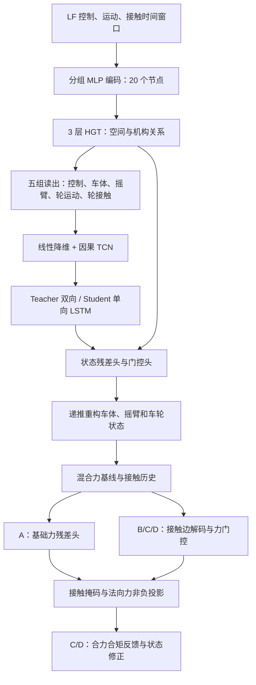

# V6 数据分布、数据特征与模型结构

更新日期：2026-10-13。本文以当前仓库实现为依据，重点介绍 `run_v6a.sh` 对应的 V6-A，同时说明 V6-B/C/D 的扩展。

## 1. 任务与统计口径

V6 用低保真仿真（LF）的控制、运动和接触信息，学习与高保真仿真（HF）的差异，输出补偿后的车体、悬架、车轮状态及六轮接触力。它是有 LF 输入的时空补偿模型。

数据主文件为 `Feature_Selection/DataSet/merged_error_dataset.csv`。以下规模统计来自该目录的 `invalid_check_log.txt`，划分和窗口统计来自 `results_v6/v6_a/pipeline_20261009_165935_62471/data/`。CSV 表头已核对为 1185 列；生成日志的 690 个工况、各工况行数与 V6 报告的窗口数逐集核对一致。本文没有重新扫描约 19 GB CSV 的所有数值，因此不把生成日志统计写成新一次全量数值审计。

模型结构以 `models/graph_temporal_hgt_compensation_v6.py`、`models/runtime_v6.py` 和训练入口为准。默认超参数指训练入口默认值；具体运行应以该次配置和 checkpoint 为准。

## 2. 数据来源与分布

### 2.1 两类工况

| 数据来源 | 工况命名 | 工况数 | 对齐后的行数 | 行数占比 | 每工况行数：最小 / 中位数 / 最大 |
|---|---|---:|---:|---:|---:|
| 普通多工况（multi） | `case0001`～`case0600` | 600 | 876,439 | 66.69% | 360 / 1,420 / 3,121 |
| 长加速工况（longaccel） | `longaccel_case0001`～`longaccel_case0090` | 90 | 437,786 | 33.31% | 1,190 / 4,495 / 11,870 |
| 合计 | 两种前缀区分来源 | 690 | 1,314,225 | 100% | — |

生成日志记录普通工况 LF/HF 分别来自 `Multi_Custom_output` / `Multi_SPH_output`，长加速工况来自 `LongAccel_Custom_output` / `LongAccel_SPH_output`。这些是生成时的数据来源，训练实际读取合并 CSV。

长加速工况只占工况数的 13.04%，却占约三分之一的数据行。训练按滑动窗口采样，序列越长贡献的窗口越多，所以工况数均衡不等于训练样本均衡。相邻窗口高度重叠，窗口数也不等于独立轨迹数。

### 2.2 训练、验证、测试划分

采用完整 `case_name` 划分，默认随机种子 42，目标工况比例为 70% / 15% / 15%。同一工况不会被拆到不同集合。实际计数受四舍五入影响。

| 集合 | 普通工况 | 长加速工况 | 总工况 | 原始行数 | 有效 V6 窗口数 | 窗口占比 |
|---|---:|---:|---:|---:|---:|---:|
| 训练 | 420 | 63 | 483 | 912,343 | 904,132 | 69.42% |
| 验证 | 97 | 7 | 104 | 174,356 | 172,588 | 13.25% |
| 测试 | 83 | 20 | 103 | 227,526 | 225,775 | 17.33% |
| 合计 | 600 | 90 | 690 | 1,314,225 | 1,302,495 | 100% |

当前划分是随机工况划分，没有按 multi / longaccel 分层。验证集只有 7 个长加速工况，测试集有 20 个。因此验证、测试的来源组成不同；比较泛化表现时，建议同时报告两类工况各自的误差。

### 2.3 时间窗口与样本量

默认 `history_len=9`、`teacher_future_len=3`、`body_rollout_len=5`：

- Student 窗口：`[t-9, ..., t]`，共 10 帧。
- Teacher 窗口：`[t-9, ..., t, ..., t+3]`，共 13 帧，未来帧也是 LF 输入。
- 默认一次训练样本连续重构 5 个时刻；各时刻使用各自的窗口，并递推上一时刻预测状态。
- 窗口不跨工况；预测区间出现非递增时间时会被排除。

对当前默认配置，一个满足时间条件、长度为 `n` 的工况产生 `n-9-5-3=n-17` 个窗口。当前三集均满足“行数减去 17 × 工况数 = 报告窗口数”，总计舍弃 11,730 个边界位置。缓存为部分字段额外准备一步数据，不应把缓存长度直接等同于损失计算步数。

训练入口实际循环长度由 `body_rollout_len` 决定；`V6Config.rollout_steps=3` 用于启用 Pushforward 后的长度限制，两者含义不同。以上长度单位是帧，时间跨度应根据各工况实际 `time` 差值计算。

## 3. 数据组织、对齐与预处理

### 3.1 列命名

| 前缀 / 字段 | 含义 | 用途 |
|---|---|---|
| `time`、`case_name` | 时间与工况标识 | 对齐、分组、划分、构造窗口 |
| `lf_*` | 低保真状态、控制、接触及派生特征 | 网络输入、补偿基线 |
| `hf_*` | 高保真状态和接触力 | 监督及评估 |
| `res_*` | 对应 HF 与 LF 的差值 | 残差规范及监督 |
| 运行时 `v6_*` | 原始状态缓存、有效性掩码、时间步长等 | 重构与损失计算，未全部存于原始 CSV |

CSV 总列数是 1185，但不代表网络输入宽度。已保存的 V6 列规范包含 218 个 base 特征条目、170 个 proxy 特征条目、139 个 target 条目和 160 个 residual 条目；经过节点分组后，直接送入图编码器的输入是 344 维。特征列表条目、分组输入、监督列与物理缓存应分别理解。

### 3.2 LF/HF 对齐与位置坐标

`Feature_Selection/datasetProcess_v3.py` 以 LF 时间为参考，在同一工况内用 `merge_asof(direction="nearest")` 匹配 HF，容差为 0.001 秒。

HF 的全部位置列按工况统一平移，使首帧 HF 车体位置与 LF 车体位置一致；各部件使用同一个平移量，保留 HF 内部几何关系。LF 世界位置保留原值。生成日志记录：每工况处理 57 个 HF 位置列，首帧车体位置对齐误差为 0，平移前后内部几何差异最大约 `2.22e-16`。

随后生成对应的 `res = HF - LF`。对齐为标签构建步骤；Student 网络入口只接收允许的 LF / 控制 / 接触字段，HF 和 residual 不作为网络输入。

### 3.3 标准化、滤波与缺失数据

标准化器只在训练集合上拟合，按组、按列保存均值和标准差；验证、测试与推理复用保存值。四元数和代码指定的接触状态、切换字段保持原值。

轮接触输入中的 Fx/Fy/Fz 使用截止频率 5 Hz 的因果一阶低通，系数根据已观测的相邻 `dt` 计算，并在工况内递推。不能把该规则理解为全部 CSV 列都进行了低通。

角速度由同工况四元数及相邻时间差进行因果计算；轮自转速度 `omega` 使用独立导出值，或由世界角速度在轮轴方向上的投影获得。LF 自转数据缺失时可以用纯滚动速度估计，默认轮半径 0.135 m，同时保留缺失标记；缺失 HF 标签通过掩码排除，不能把填充值当真实标签。

现有报告中六轮均启用 omega 监督，LF omega 缺失比例均为 0。生成日志记录目标 residual 列任意 NaN 的行数为 0，并逐工况记录对齐 HF 无缺失、res 无 NaN/Inf。以上为已有报告结论；不表示所有可选字段均已做新一次统计。V6 加载器另外检查必需 LF 输入是否有限，异常会报错。

## 4. V6 输入特征

### 4.1 图节点特征

| 节点组 | 数量 | 每节点输入维度 | 主要内容 |
|---|---:|---:|---|
| 控制 `control_context` | 1 | 1 | `lf_cmd_speed` |
| 车体 `body` | 1 | 19 | 位置 3、速度 3、加速度 3、四元数 4、角速度 3、角加速度 3 |
| 摇臂 `lf/lm/lb/rf/rm/rb` | 6 | 13 | 位置 3、速度 3、加速度 3、四元数 4 |
| 车轮运动 `wheel{i}_kin` | 6 | 25 | 位置、速度、加速度、四元数、角速度、角加速度、相对位置与相对速度 |
| 车轮接触 `wheel{i}_contact` | 6 | 16 | Fx/Fy/Fz、Mx/My/Mz 及各自 `_std`、接触状态、沉陷、纵横向滑移 |
| 合计 | 20 | 344（各节点维度之和） | `1+19+6×13+6×25+6×16` |

摇臂命名中 `lf/lm/lb` 对应左侧前、主/后、副摇臂，`rf/rm/rb` 为右侧对应部件。车轮 0/2/4 为左前/中/后，1/3/5 为右前/中/后。轮运动特征的相对量为 LF 派生量，不是 HF 残差。

V6 显式过滤部分时间、工况时段、冗余姿态、upright、加速度统计及接触变化率字段；具体以 `filter_v6_input_feature_cols()` 为准。不能直接把 V5 或完整 CSV 的列数当成 V6 输入。

### 4.2 接触历史及物理辅助特征

| 数据结构 | 维度 | 内容及启用条件 |
|---|---:|---|
| 基础轮接触历史 | 每轮每帧 7 | `in_contact, sinkage, slip_long, slip_lat, rel_vel_x/y/z`；V6-A 力分支保留 |
| 原始接触描述 | 每轮 15 | 接触标记、法向 3、沉陷、滑移 2、相对速度 3、轮心 3、omega、转向角 |
| 增强剪切历史 | 每轮每帧 8 | 累积剪切、切向速度、滑移变化、接触持续时间、沉陷和归一化自转；B/C/D 默认启用 |
| 物理图节点描述 | 每节点 32 | 位置、速度、旋转矩阵、角速度及依节点类型填入的机构/接触量；供物理边或物理注意力使用 |

物理节点描述转换为边特征后，物理消息 MLP 注入 HGT；D 还加入物理注意力偏置。部分描述槽位只对特定节点有意义。地形读取器提供接触平面、法向与地形参数，装配元数据提供机构参考点和距离约束。

V6-A 的 `enable_contact_history=false` 表示关闭**新增的增强历史模块**；基础 7 维轮接触历史编码器仍在力分支中使用。V6-A 也保留装配和运动学损失、法向力基线及接触投影，不能理解为完全没有物理信息。

## 5. 模型结构

### 5.1 总体流程



图中扩展方框表示相应预设的功能。Teacher/Student 状态阶段直接结束于状态重构，不运行力分支。

### 5.2 异构图与空间编码

图有 20 个节点、5 类节点和 7 类关系；默认包含自环，共 96 条有向边：

| 关系 | 有向边数 | 含义 |
|---|---:|---|
| `self_loop` | 20 | 每节点自身信息 |
| `control_excitation` | 12 | 控制到六个摇臂和六个轮运动节点 |
| `kinematic_transfer` | 24 | 左右车体—摇臂—车轮机构双向关系 |
| `motion_to_contact` | 6 | 轮运动到对应接触 |
| `contact_to_motion` | 6 | 接触到对应轮运动 |
| `longitudinal_coupling` | 16 | 同侧前中、中后轮的运动与接触双向关系 |
| `lateral_coupling` | 12 | 左右对应轮的运动与接触双向关系 |

各组 MLP 将不同宽度的输入映射到统一隐藏维度。HGT 为不同节点类型使用独立 Q/K/V，为不同关系使用独立注意力和消息变换；每个时间帧先完成图上的空间信息交换。

### 5.3 时序编码与默认宽度

| 项目 | 训练入口默认值 |
|---|---:|
| 节点隐藏维度 H | 192 |
| HGT 层数 / 注意力头数 | 3 / 4 |
| 五组读出维度 | `5H = 960` |
| TCN 输入及隐藏维度 | 256 |
| TCN 卷积 | 两层，核大小 3，因果截断与残差连接 |
| LSTM 层数 / 输出维度 | 2 / 192 |
| Teacher LSTM | 双向，每方向隐藏维度 96 |
| Student LSTM | 单向，隐藏维度 192 |
| 基础接触历史隐藏维度 | 48 |
| Dropout | 0.1 |

五组读出将控制和车体节点，以及摇臂、轮运动、轮接触的组内均值拼接。时序编码后取当前索引处的 192 维 `z_t`，与当前节点及图读出特征一起送到预测头。

Teacher 用未来 LF 帧与双向 LSTM 提供训练期参考；Student 只有历史与当前帧，使用单向 LSTM。Teacher 到 Student 初始化跳过不兼容的 LSTM 参数，并使用潜变量 `z` 的 Smooth L1 蒸馏。

### 5.4 状态输出与层级重构

状态预测头输出车体位置/速度残差、姿态旋转增量、角速度修正，以及摇臂和车轮的局部位置、姿态、速度、角速度修正。轮自转使用对应的 omega 头及有效监督条件。多个部件共享同类预测头，同时输入各自节点特征。

车体位置采用递推重构：

```text
v_corrected = v_LF + gate_velocity × delta_v
p_propagated = p_previous + 0.5 × (v_previous + v_corrected) × dt
p_corrected = p_propagated + gate_position × delta_p
R_corrected = R_LF × Exp(gate_attitude × delta_rotation)
```

四元数采用标量在前的约定 `[q0,q1,q2,q3]`；姿态修正通过 SO(3) 指数映射组合，不直接相加四元数。摇臂、车轮位置继承车体的全局位移修正，再叠加车体坐标系下的局部修正；姿态也包含车体公共修正与部件局部旋转。

### 5.5 力分支

每个车轮的混合基线为 `[LF_Fx, LF_Fy, Fphy_z]`。`Fphy_z` 为训练集上拟合的轮级载荷转移回归：输入包含偏置、车体 roll/pitch、车体加速度和轮向下速度。它是数据校准基线，不能直接当成已验证的完整刚体动力学方程。

V6-A 的共享力残差头接收 `z_t`、车体/轮运动/轮接触节点、7 维历史的编码结果和当前修正状态等，默认输入宽度为 `192+3×192+48+23=839`。力输出为基线加残差，然后施加接触掩码，并将法向分量投影到非负值；离地时输出严格为零。A 的新增力门控关闭，残差门值为 1。

B/C/D 使用接触边解码器，根据修正后的轮状态、接触几何及历史产生力残差，并启用可学习力门控。默认输入力坐标约定为 `contact`：纵向、横向、向上法向；若真实仿真导出为世界坐标，必须显式匹配配置。世界角速度与轮轴自转速度也不能互相替代。

## 6. V6-A/B/C/D 的区别

| 模块开关 | A | B | C | D |
|---|:---:|:---:|:---:|:---:|
| 物理边消息 | 关 | 开 | 开 | 开 |
| 物理注意力偏置 | 关 | 关 | 关 | 开 |
| 增强接触/剪切历史 | 关 | 开 | 开 | 开 |
| 接触边力解码器 | 关 | 开 | 开 | 开 |
| 新增力门控 | 关 | 开 | 开 | 开 |
| 力—状态耦合 | 关 | 关 | 开 | 开 |
| DynamicsHead 状态修正 | 关 | 关 | 开 | 开 |
| 同时刻物理迭代细化 | 关 | 关 | 关 | 开 |
| Pushforward 训练 | 关 | 关 | 关 | 开 |

`run_v6a.sh` 固定设定 `ABLATION=v6_a`。表格是 `V6Config.preset()` 的默认设置；直接调用训练程序可以覆盖开关，因此 checkpoint 内的实际配置更权威。

C/D 汇总六轮世界坐标接触合力与相对指定参考点的合矩，将相对 LF 的力/矩变化反馈给学习型 DynamicsHead。D 增加同一时刻的状态—接触力细化，默认迭代 1 次，可设 2 次。它不同于向下一个时刻积分。

默认 `dynamics_calibrated=false`、惯量为零占位、`lambda_dyn=0`。只有确认整车质心状态、质量和正的惯量后才允许启用相应动力学损失；启用 DynamicsHead 并不自动意味着启用了校准动力学损失。

## 7. 训练阶段、损失与推理

### 7.1 分阶段训练

| 阶段 | 主要训练内容 | 初始化 / 依赖 |
|---|---|---|
| `state_teacher` | 图与时序骨干、状态修正头 | Teacher，未来 LF 窗口 |
| `state_student` | 因果骨干与状态修正，潜变量蒸馏 | Teacher checkpoint；LSTM 单独初始化 |
| `force` | 力历史/解码/门控分支 | 冻结 Student 状态参数 |
| `physics` | DynamicsHead | 适用耦合预设，依赖力 checkpoint |
| `joint` | 力、动力学及选定状态层 | 默认包含最后一层 HGT 和部分状态头 |

V6-A 流水线为 `Teacher → Student → Force → Joint`，跳过独立 physics 阶段。各阶段默认最多 100 epoch，patience 为 15；验证选择分数连续 15 个 epoch 没有降低时早停。选择分数为指标汇总的 physical score 加 `0.01 × assembly loss`，不能直接等同于进度条的 Body_MAE。

### 7.2 损失构成

状态损失包含最终 HF 状态误差、残差项、相对 LF 的改善项、门控监督、装配几何约束、位置/速度与姿态/角速度一致性、局部修正正则、车体修正平滑和短 rollout 误差。力阶段增加最终接触力、力残差、改善项、残差正则及短 rollout 误差；力门控与动力学损失仅在对应条件满足时加入。

默认重要权重：`w_state=1`、`w_force=1`、`w_physics=1`、`w_gate=0.1`、`w_rollout=0.05`、`lambda_improve=0.05`、`lambda_assembly=0.02`、`lambda_kin=0.005`、`lambda_distill_z=1`、`lambda_dyn=0`。缺失标签按掩码处理，不能当成零目标。

### 7.3 推理模式与适用范围

- `lf_conditioned`：连续读取 LF 状态，结合上一时刻修正状态递推补偿。
- `autonomous`：用上一时刻预测运动状态更新输入历史，但控制、地形、接触观测仍作为外生输入。

所以 autonomous 是有接触观测的状态自回归补偿，不是完全无 LF 观测的闭环仿真器。D 的 Pushforward 为这种递推路径增加训练监督。

评估应同时报告状态误差、各轮 Fx/Fy/Fz、与 LF/混合基线的对比及机构一致性，并按普通/长加速工况分别汇总。数据生成日志没有给出各数值特征的分位数、控制速度分布、采样间隔分布或接触比例，本文不推断这些范围。本文中的样本规模与模型说明也不代表已经获得最终测试性能。

## 8. 依据与文件索引

| 文件 | 用途 |
|---|---|
| [合并数据生成脚本](Feature_Selection/datasetProcess_v3.py) | 来源、时间匹配、统一平移、残差生成 |
| [数据生成日志](Feature_Selection/DataSet/invalid_check_log.txt) | 工况行数、来源规模、生成期质量记录 |
| [V6 数据报告](results_v6/v6_a/pipeline_20261009_165935_62471/data/data_report.json) | 三集窗口数、自转监督与缺失比例 |
| [V6 列规范](results_v6/v6_a/pipeline_20261009_165935_62471/data/column_spec_v6.json) | 每组完整列名与顺序 |
| [V6 划分清单](results_v6/v6_a/pipeline_20261009_165935_62471/data/split_manifest.json) | 各集合完整工况列表 |
| [V6 配置](models/config_v6.py) | 预设、开关和物理约定 |
| [V6 数据实现](models/data_utils_v6.py) | 过滤、标准化、窗口、掩码和物理缓存 |
| [基础数据实现](models/data_utils.py) | 共享分组、按工况划分和标准化规则 |
| [V6 模型](models/graph_temporal_hgt_compensation_v6.py) | HGT、TCN、LSTM、预测头和耦合路径 |
| [共享重构与损失](models/runtime_v6.py) | 训练/推理共用的状态重构、力基线和损失 |
| [物理模块](models/physics_modules_v6.py) | SO(3)、接触坐标、合力合矩与状态细化 |
| [载荷转移基线](models/load_transfer_force_v6.py) | 训练集校准的轮法向力回归 |
| [训练入口](train/train_graph_model_v6.py) | 默认架构宽度、训练阶段、早停 |
| [V6 流水线](train_pipeline_v6.sh) / [V6-A 入口](run_v6a.sh) | 阶段执行、验证与连续推理 |
